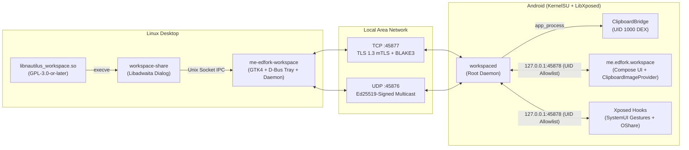

<div align="center">
  <p>
    
  </p>
  <h1>Universe Workstation</h1>
  <p><strong>Zero-Cloud Bidirectional mTLS 1.3 LAN Bridge for Linux Desktop &amp; Rooted Android</strong></p>
  <p>
    <a href="version.properties"></a>
    <a href="LICENSE"></a>
    <a href="crates/workspace-nautilus/LICENSE"></a>
    <a href="Cargo.toml"></a>
    <a href="android/app/build.gradle.kts"></a>
  </p>
</div>

---

## Overview

**Universe Workstation** (*Chinese UI name: 寰宇工作台*, current release **`1.0 Ant` / `1.0-ant`**) is a zero-cloud, local-network collaboration bridge connecting **Linux Desktop (Wayland / X11)** and **Rooted Android (KernelSU + LibXposed)** devices. It provides mutually authenticated LAN discovery and pairing, lossless text & image clipboard synchronization, high-speed streaming file transfers, GNOME Nautilus shell integration, and native ColorOS / OPPO Share & Fluid Cloud system integration.

> [!CAUTION]
> **High-Privilege Modifications (Root & Xposed)**: The Android components install a KernelSU module executing a `UID 0` (`root`) background daemon (`workspaced`), launch a `UID 1000` (`system`) binder bridge via `app_process`, modify system `appops` policies, and inject runtime **LibXposed (API 102)** hooks into critical system processes (`com.android.systemui` and `com.coloros.oshare`). Misconfiguration, unsupported ROM builds, or OTA updates may trigger SystemUI crashes or bootloops. Read **[Tested Scope & Compatibility](#tested-scope--compatibility)** and **[Risk Warning & Disclaimer](#risk-warning--disclaimer)** carefully before flashing or enabling modules.

## Key Features

- **Zero-Trust Local Network Security**
  - **Signed Discovery**: UDP multicast beacons (`45876/udp`) are signed with each device's persistent **Ed25519** private key to prevent LAN spoofing.
  - **SAS Verification**: Pairing derives a 6-digit Short Authentication String (SAS) bound via HKDF-SHA256 to both peers' public keys before committing mutual trust.
  - **Pinned mTLS 1.3**: All RPCs, clipboard payloads, and file streams travel over **TLS 1.3 mutual authentication (`45877/tcp`)** with pinned ECDSA P-256 certificates and immediate per-device revocation.
- **Lossless Bidirectional Clipboard Sync**
  - Supports UTF-8 plain text (up to `1 MiB`) and raw images (PNG, JPEG, WebP up to `20 MiB`) with SHA-256 verification and echo-loop deduplication.
  - **Linux**: Native integration with Wayland (`wl-clipboard`) and X11 (`xclip`) selection monitoring and write-back.
  - **Android**: Root daemon `workspaced` launches the `UID 1000` (`AID_SYSTEM`) `ClipboardBridge` DEX for reliable system clipboard access; synced images are served via an exported `ClipboardImageProvider` with exact byte sizes and explicit URI grants so third-party apps (such as WeChat) paste full-resolution images cleanly.
- **Streaming File Transfers & Linux Desktop Integration**
  - Streaming HTTP/1.1 transfers over mTLS with incremental **BLAKE3** checksum verification and automatic collision-safe renaming under `~/Downloads/寰宇工作台` (Linux) and `/storage/emulated/0/Download/寰宇工作台` (Android).
  - **GTK4 Frosted Liquid Glass UI**: Smoothly animated desktop app with Light / Dark / System appearance modes and customizable username & device name.
  - **Native System Tray & Nautilus 4 Extension**: Pure-Rust D-Bus `StatusNotifierItem` tray (zero GTK3 linkage), GNOME Nautilus 4 context-menu plugin (`Share with Workspace`), and a Libadwaita quick-send dialog (`workspace-share`).
- **Deep Android & ColorOS Integration**
  - **Native OPPO Share (OShare) Injection**: LibXposed `API 102` hooks inject online paired Linux workstations directly into the system OPPO Share sheet for one-tap LAN file sending.
  - **LAN-Gated Two-Finger Swipe Gestures**: `SystemUI` hooks detect two-finger swipe up (push clipboard) and swipe down (pull clipboard), strictly active only when LAN-connected, sync is unpaused, and gestures are enabled.
  - **ColorOS Fluid Cloud Live Capsules & Adaptive Compose UI**: Real-time clipboard/transfer capsules via Fluid Cloud notifications, foldable tablet & compact single-hand layouts, and customizable frosted wallpapers.

## System Architecture



## Security Model

- **Device Identity**: Persistent Ed25519 identity keypair + hardware-independent self-signed ECDSA P-256 TLS certificate with pinned SPKI fingerprints.
- **No Cloud & No Implicit Trust**: Unpaired peers can only view signed discovery beacons and initiate a 6-digit SAS pairing session; every `/v1/*` data endpoint requires a pinned, non-revoked client certificate.
- **Localhost IPC Hardening (Android)**: `workspaced` binds local control IPC strictly on `127.0.0.1:45878` and authenticates the calling process UID via kernel `/proc/net/tcp` and `/proc/net/tcp6` socket inode lookup, allowing only `root`, `system` (`1000`, `SystemUI`), `me.edfork.workspace`, and `com.coloros.oshare`.

## Repository Structure

```text
.
├── Cargo.toml                  # Rust workspace (workspace-core / linux / share / nautilus / android)
├── version.properties          # Single source of truth for version (1.0-ant / 1.0 Ant / versionCode 100)
├── LICENSE                     # Root MIT License and component notice
├── THIRD_PARTY_NOTICES.md      # Full third-party license compliance & attributions
├── licenses/                   # Verbatim Apache-2.0, GPL-3.0-or-later, LGPL-2.1-or-later & MPL-2.0 texts
├── assets/                     # App icons, desktop entry (.desktop) & systemd user unit template
├── scripts/
│   ├── sync-version.sh         # Syncs version.properties into Cargo.toml, KSU & Xposed manifests
│   ├── build-linux.sh          # Runs Clippy, tests & release build under dist/linux/
│   ├── install-linux.sh        # Installs binaries, icons, .desktop & systemd user unit
│   └── build-android.sh        # Builds DEX, aarch64 workspaced, Gradle APK & KernelSU module zip
├── crates/
│   ├── workspace-core/         # Protocol, Ed25519/mTLS crypto, UDP discovery, storage & BLAKE3 transfer
│   ├── workspace-linux/        # Linux daemon, Wayland/X11 clipboard, SNI tray & GTK4 frosted UI
│   ├── workspace-share/        # GTK4 + Libadwaita quick-send file chooser dialog
│   ├── workspace-nautilus/     # GNOME Nautilus 4 extension (independently GPL-3.0-or-later)
│   └── workspace-android/      # Android KernelSU root daemon & UID-authenticated localhost IPC
└── android/
    ├── app/                    # Compose UI, ClipboardImageProvider, Fluid Cloud & LibXposed hooks
    ├── bridge-dex/             # Standalone UID 1000 ClipboardBridge DEX (ClipboardBridge.java)
    └── ksu-module/             # KernelSU module packaging (module.prop / customize.sh / service.sh)
```

## Tested Scope & Compatibility

This project is actively developed and verified only on the specific environments listed below. Behavior outside this matrix is **untested** and must be treated as experimental.

### Verified Test Matrix

| Layer | Tested Environment (Verified) | Minimum / Declared Target | Untested / Unsupported Scope |
| :--- | :--- | :--- | :--- |
| **Linux Desktop OS** | **Arch Linux** (`x86_64`, rolling) | 64-bit Linux + systemd user session | Ubuntu / Debian / Fedora package lists are provided on a best-effort basis without full end-to-end regression testing |
| **Display & Tray** | **Wayland** (`Hyprland`, `wl-clipboard`, D-Bus SNI) | Wayland or X11 (`xclip`) | X11 clipboard paths are implemented but receive limited real-hardware verification |
| **Linux Toolkits** | `gtk4` (`4.24.x`), `libadwaita` (`1.10.x`), `libnautilus-extension` (`51.x`) | `gtk4 >= 4.14`, `libadwaita >= 1.4`, `libnautilus-extension-4 >= 43.0` | GTK3 / older GNOME Nautilus (`extensions-3`) are unsupported |
| **Android Device & ROM** | **ColorOS 16 / Android 16** (`arm64-v8a`, OPPO Find N6 foldable & compact form factors) | `arm64-v8a`, Android 12+ (`minSdk = 31`, `targetSdk = 36`, `compileSdk = 37`) | AOSP, Pixel OS, HyperOS/MIUI, One UI, OriginOS, `armeabi-v7a` / `x86_64`, and non-ColorOS OShare/Fluid Cloud builds are untested |
| **Root Framework** | **KernelSU** (`me_edfork_workspace` module running `workspaced` as `UID 0` & `ClipboardBridge` as `UID 1000`) | KernelSU with `/data/adb/modules` & `su` | **Magisk** and **APatch** are untested (`customize.sh` / `service.sh` behavior unverified) |
| **Xposed Framework** | **Vector (`LibXposed API 102`)** with `exceptionMode=protective` | `LibXposed API >= 102` (LSPosed / Vector) | Legacy Xposed (`API 82/93`) and frameworks below `API 102` are unsupported |

### System Hook & OTA Fragility Notice

- **Obfuscated Vendor Targets (`com.coloros.oshare`)**: Native OPPO Share injection hooks version-specific obfuscated classes and methods (such as `v9.a`, `DirectShareServer`, and `OShareClient`). ColorOS firmware updates or OPPO Share app updates may alter those signatures and break OShare injection until updated.
- **Boot-Critical Process (`com.android.systemui`)**: Two-finger clipboard gesture detection runs inside SystemUI. Incompatible ROMs or major Android OS upgrades can cause SystemUI instability or crash loops.
- **ColorOS-Specific Features**: Fluid Cloud live update capsules rely on ColorOS notification extensions (`FluidCloudProvider`) and will not display as system capsules on non-ColorOS ROMs.

### Emergency Recovery (Bootloop & Crash Mitigation)

Before installing any system OTA or updating `com.android.systemui` / `com.coloros.oshare`, **disable Universe Workstation in your Xposed manager first**.

If your device encounters a bootloop or continuous `SystemUI` crash:
1. **KernelSU Safe Mode**: Reboot and repeatedly press **Volume Down** during boot until KernelSU enters Safe Mode (disabling all KernelSU modules, including `me_edfork_workspace`).
2. **Manual Removal via Recovery / ADB Root Shell**:
   ```bash
   rm -rf /data/adb/modules/me_edfork_workspace /data/adb/workspace /data/local/tmp/workspace
   ```
3. **Xposed Safe Mode**: Trigger your Xposed manager's module-disable shortcut (or disable `me.edfork.workspace` scope after booting into KernelSU Safe Mode) before rebooting normally.

## Building & Installing from Source

### 1. Linux Desktop

**Dependencies**:
- Rust toolchain (`rustc` / `cargo`), C compiler (`gcc` / `clang`), `pkg-config`
- `gtk4` (`>= 4.14`), `libadwaita-1` (`>= 1.4`), `libnautilus-extension-4` (`>= 43.0`, optional for Nautilus plugin)
- Runtime clipboard helpers: `wl-clipboard` (Wayland) or `xclip` (X11)

```bash
# Arch Linux
sudo pacman -S --needed rust base-devel pkgconf gtk4 libadwaita libnautilus-extension wl-clipboard xclip

# Ubuntu / Debian (24.04+)
sudo apt install cargo rustc build-essential pkg-config libgtk-4-dev libadwaita-1-dev libnautilus-extension-dev wl-clipboard xclip

# Fedora
sudo dnf install cargo rust gcc pkgconf-pkg-config gtk4-devel libadwaita-devel nautilus-devel wl-clipboard xclip
```

**Build & Install**:

```bash
# 1. Run Clippy, workspace tests, and build release artifacts into dist/linux/
./scripts/build-linux.sh

# 2. Install binaries, icons, desktop entry, and systemd user service
./scripts/install-linux.sh

# 3. Enable and start background tray daemon
systemctl --user daemon-reload && systemctl --user enable --now me-edfork-workspace.service

# 4. (Optional) Install GNOME Nautilus 4 right-click extension ("Share with Workspace")
sudo install -m 0755 dist/linux/libnautilus_workspace.so /usr/lib/nautilus/extensions-4/libnautilus_workspace.so
nautilus -q
```

**Firewall Ports**:

```bash
# Example for UFW
sudo ufw allow 45876/udp comment 'Workspace LAN Discovery'
sudo ufw allow 45877/tcp comment 'Workspace LAN mTLS'
```

**CLI Reference**:

```bash
me-edfork-workspace --version   # Print version: 1.0 Ant (1.0-ant)
me-edfork-workspace --silent    # Start daemon + tray silently without opening window
me-edfork-workspace status      # Show daemon status and connected peers
me-edfork-workspace peers       # List paired and nearby LAN peers
me-edfork-workspace send <peer_id> <file1> [file2...]
```

---

### 2. Android (KernelSU + LibXposed)

> **Device Requirements**: Android 12+ (`API 31+`, designed for ColorOS / OnePlus / OPPO), rooted with **KernelSU**, and an **API 102 LibXposed** module manager (LSPosed / Vector).

**Build Prerequisites**:
- JDK 17+
- Android SDK (Platform 36 / 37, Build-Tools with `d8`); set `ANDROID_HOME` (auto-detects `~/Android/Sdk`, `~/Library/Android/sdk`, or `/opt/android-sdk`)
- Android NDK r27+
- Rust Android target: `rustup target add aarch64-linux-android`

**Build & Deploy**:

```bash
# Build workspace-bridge.jar, cross-compile aarch64 workspaced, run unit tests & package APK + KSU zip
./scripts/build-android.sh
```

Artifacts are written to `dist/android/`:
1. **Install the Android App**:
   ```bash
   adb install -r dist/android/me.edfork.workspace.apk
   ```
2. **Flash the KernelSU Module**: Push `dist/android/me_edfork_workspace-ksu.zip` and install it via KernelSU Manager (or `ksud module install`). It installs `workspaced` and `workspace-bridge.jar`, starts the background daemon cleanly across reboots, and applies clipboard/background exemptions.
3. **Configure Xposed Scope**: Enable **Universe Workstation** (`寰宇工作台`) in your LSPosed / Vector manager with scope:
   - `com.android.systemui` — LAN-gated two-finger swipe clipboard gestures
   - `com.coloros.oshare` — Native OPPO Share LAN PC injection
4. **Enable Live Updates (Optional)**: Open the app → **Settings** → grant ColorOS Fluid Cloud permission.

> For offline builds, set `WORKSPACE_OFFLINE=1` before running `./scripts/build-linux.sh` or `./scripts/build-android.sh`.

## Unified Version Management

[`version.properties`](version.properties) serves as the single source of truth for all version identifiers:

```properties
VERSION_NAME=1.0-ant
VERSION_DISPLAY=1.0 Ant
VERSION_CODE=100
CARGO_VERSION=1.0.0-ant
```

Running `./scripts/sync-version.sh` (automatically invoked by build scripts) synchronizes this version across:
- Root [`Cargo.toml`](Cargo.toml) (`workspace.package.version`) and CLI `-V` / `--version` outputs
- Linux GTK4 UI and Android Jetpack Compose UI headers & Settings node cards
- KernelSU module manifest [`android/ksu-module/module.prop`](android/ksu-module/module.prop)
- LibXposed module manifest [`android/app/src/main/resources/META-INF/xposed/module.prop`](android/app/src/main/resources/META-INF/xposed/module.prop)
- Android APK `versionCode` and `versionName`

## Risk Warning & Disclaimer

> [!WARNING]
> **Read Carefully Before Use**: Unlocking bootloaders, flashing Root/KernelSU modules, and hooking Android system processes carry serious technical, security, and financial/warranty risks. By compiling, installing, or using this software, you acknowledge and accept all terms below.

1. **Bootloader Unlock, Warranty & Device Integrity**
   - Unlocking a device bootloader and installing KernelSU / LibXposed modules will typically **void manufacturer warranty**, may permanently trigger hardware security fuses or TEE attestation changes, downgrade **Widevine DRM (L1 → L3)**, disable **Google Play Integrity / Strong Integrity**, and break **banking, digital payment, NFC wallet, or corporate MDM applications**.
2. **Privileged Execution (`UID 0` / `UID 1000`) & System Instability**
   - The KernelSU module runs `workspaced` as **`root` (`UID 0`)**, executes `ClipboardBridge` via `app_process` as **`system` (`UID 1000`)**, persistently grants `READ_CLIPBOARD` / `WRITE_CLIPBOARD` and background execution exemptions via `appops` / `dumpsys deviceidle` / `am set-standby-bucket`, and injects hooks into **`com.android.systemui`** and **`com.coloros.oshare`**.
   - Improper setup, ROM mismatches, SELinux policy conflicts, or firmware updates can result in **SystemUI crash loops, soft-bricks, bootloops, elevated battery drain, or data loss**. Always back up critical user data (`adb` / recovery backup) before installation.
3. **Clipboard & Local Network Privacy**
   - Clipboard synchronization automatically forwards copied text and images between paired peers, and background clipboard exemptions weaken standard Android background-clipboard isolation for `me.edfork.workspace`.
   - Disable or pause clipboard synchronization before copying passwords, one-time codes, private keys, or sensitive information. Only pair devices that you personally own and control, and only operate on trusted local area networks.
4. **Third-Party Risk-Control & Anti-Cheat Detection**
   - Running persistent `su` daemons, overriding `appops` policies, accessing clipboard contents via `UID 1000`, or loading Xposed frameworks in `SystemUI` may be flagged by **anti-cheat systems, messaging risk controls, financial apps, or enterprise security monitors**, potentially resulting in **account warnings, restrictions, or bans**. You assume sole responsibility for such outcomes.
5. **Lawful Use & Limitation of Liability ("AS IS")**
   - This software is intended strictly for personal interoperability research and lawful use on **devices you own or have explicit authorization to modify**. Do not use it to access third-party data or bypass organizational security controls.
   - **THIS SOFTWARE IS PROVIDED "AS IS", WITHOUT WARRANTY OF ANY KIND, EXPRESS OR IMPLIED.** IN NO EVENT SHALL THE AUTHORS OR COPYRIGHT HOLDERS BE LIABLE FOR ANY DIRECT, INDIRECT, INCIDENTAL, SPECIAL, EXEMPLARY, OR CONSEQUENTIAL DAMAGES (INCLUDING BUT NOT LIMITED TO BRICKED DEVICES, DATA LOSS, CORRUPTED FILES, WARRANTY LOSS, SECURITY BREACHES, OR ACCOUNT SUSPENSIONS) ARISING IN ANY WAY OUT OF THE USE OF THIS SOFTWARE.

## License & Compliance

- The core workspace crates, Linux GUI & CLI, `workspace-share`, Android application, `workspaced`, and `ClipboardBridge` DEX are licensed under the **[MIT License](LICENSE)**.
- The GNOME Nautilus 4 extension ([`crates/workspace-nautilus`](crates/workspace-nautilus)) links `libnautilus-extension-4` and is separately licensed under **[GPL-3.0-or-later](crates/workspace-nautilus/LICENSE)**. It interacts with `workspace-share` strictly via OS process execution (`execve`).
- All third-party Rust crates, AndroidX / Kotlin / LibXposed dependencies, dynamically linked system libraries (GTK4, Libadwaita, GLib, Cairo, Pango, GdkPixbuf), and required verbatim copyright/attribution notices are documented in **[THIRD_PARTY_NOTICES.md](THIRD_PARTY_NOTICES.md)** with full license texts under [`licenses/`](licenses/) and automatically bundled into `dist/` release artifacts and APK `assets/`.
- Trademarks such as Linux, GNOME, Nautilus, Android, OPPO, OnePlus, ColorOS, OShare, KernelSU, and LSPosed belong to their respective owners; Universe Workstation is an independent open-source project.
